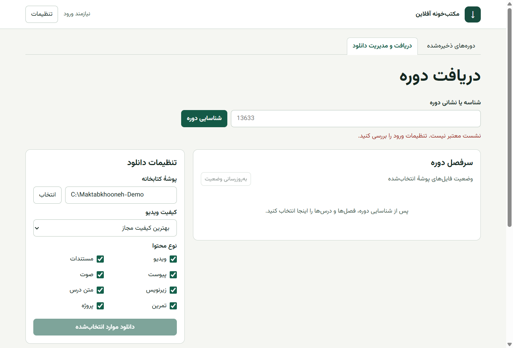
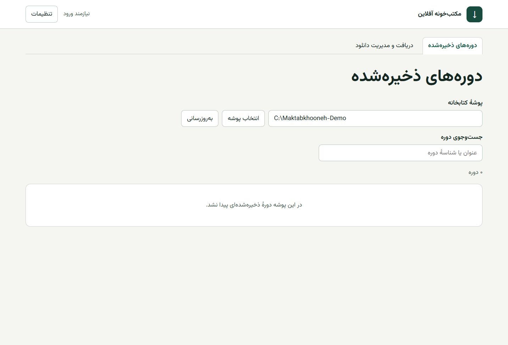
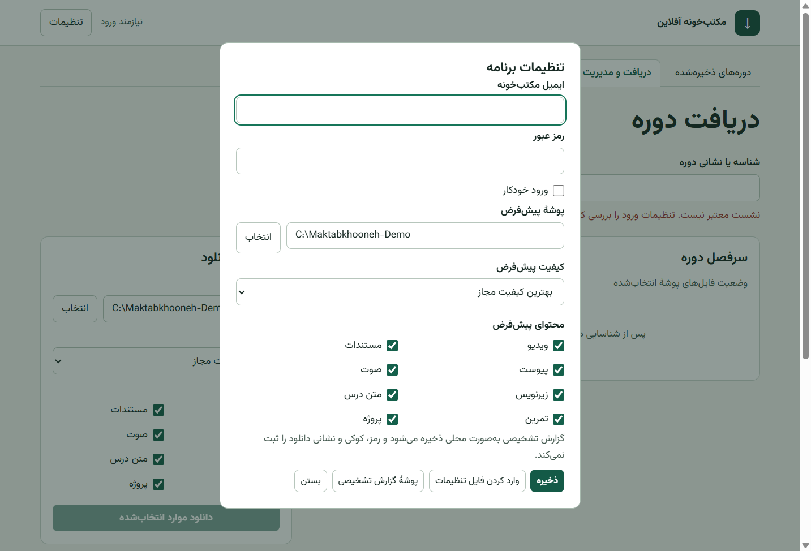

# دانلودر مکتب‌خونه (Maktabkhooneh Downloader)

برنامهٔ ویندوزی با رابط گرافیکی و ابزار خط فرمان برای ذخیره و دسته‌بندی آفلاین محتوایی که مکتب‌خونه برای حساب شما قابل دانلود کرده است. اجرای کد منبع به Node.js 22 یا جدیدتر و نصب وابستگی‌های npm نیاز دارد.

## تصاویر برنامه

تصاویر زیر از اجرای واقعی برنامه با تنظیمات موقت، بدون ورود به حساب و با کتابخانهٔ خالی تهیه شده‌اند.

**دریافت و مدیریت دانلود**



**کتابخانهٔ دوره‌های ذخیره‌شده**



**تنظیمات برنامه**



## اجرا در PowerShell

برای ساخت خودکار ویندوز، گردش‌کار **Build Windows application** را از بخش Actions به‌صورت دستی اجرا کنید؛ خروجی در بخش artifacts اجرای موفق قرار می‌گیرد. برای انتشار، نسخهٔ `package.json` را تنظیم و تگ هم‌نام مانند `v1.0.0` را پوش کنید. پس از موفقیت آزمون‌ها و ساخت، فایل نصبی، نسخهٔ قابل‌حمل و `SHA256SUMS.txt` در GitHub Releases منتشر می‌شوند. فایل‌ها در حال حاضر امضای دیجیتال ندارند.

برای اجرای رابط گرافیکی از کد منبع و ساخت بسته‌های ویندوز:

```powershell
npm install
npm run dev
npm run build
```

اگر دسترسی به رجیستری npm قطع است، می‌توان از یک بستهٔ بازشدهٔ Electron و کامپایلر NSIS استفاده کرد:

```powershell
pwsh -File .\packaging\build-nsis.ps1 -Compiler 'C:\Tools\NSIS\makensis.exe'
```

این مسیر از `dist/windows-unpacked` بستهٔ نصب و نسخهٔ قابل‌حمل تک‌فایلی می‌سازد.

در رابط گرافیکی، شناسایی دوره فقط فهرست و گزینه‌های کیفیت را دریافت می‌کند. دانلود با تأیید جداگانه آغاز می‌شود. تنظیمات برنامه در پوشهٔ کاربر ویندوز ذخیره می‌شوند. در پنجرهٔ تنظیمات می‌توانید فایل `.env` قبلی را وارد کنید.

برای عیب‌یابی، رابط گرافیکی رویدادهای اصلی دانلود، کدهای خطای فایل و دستهٔ خطای شبکه را در فایل‌های `diagnostics.log` در پوشهٔ `logs` داده‌های برنامه ذخیره می‌کند. از تنظیمات، «پوشهٔ گزارش تشخیصی» را باز کنید؛ اگر ثبت گزارش شکست بخورد، هشدار در تنظیمات نمایش داده می‌شود و پس از موفقیت ثبت بعدی برطرف می‌شود. حداکثر فایل جاری و سه نسخهٔ قبلی، هر کدام حدود یک مگابایت، نگهداری می‌شود. رمز، کوکی، متن خام خطا، نشانی دانلود و مسیر فایل‌ها ثبت نمی‌شوند. این گزارش مخصوص نسخهٔ گرافیکی است.

بخش «دوره‌های ذخیره‌شده» فهرست کتابخانهٔ انتخابی را از روی فایل‌های محلی نشان می‌دهد. از همین بخش می‌توان نمایهٔ آفلاین یا پوشهٔ دوره را باز کرد و برای دانلود موارد باقی‌مانده، درس‌ها را دوباره انتخاب کرد.

برای استفاده از خط فرمان:

```powershell
Set-Location 'C:\path\to\maktabkhooneh-downloader'
npm install
Copy-Item .env.example .env
node .\download.mjs 13633 --list-only
node .\download.mjs 13633 --output 'D:\Courses\Maktabkhooneh' --quality best
```

مقادیر `MK_EMAIL` و `MK_PASSWORD` را در فایل محلی `.env` وارد کنید. این فایل و تنظیمات ذخیره‌شدهٔ رابط گرافیکی حاوی رمز به‌صورت متن هستند؛ از آن‌ها محافظت کنید و در مخزن یا برای دیگران ارسال نکنید. رمز دارای فاصله یا `#` باید داخل کوتیشن باشد. Node.js از اولین `#` خارج از کوتیشن به بعد را توضیح می‌خواند، حتی اگر این علامت آخرین نویسهٔ رمز باشد. اگر رمز شامل هر دو نوع کوتیشن است، آن را در بک‌تیک (کاراکتر U+0060) قرار دهید. با `MK_AUTO_LOGIN=true` برنامه ابتدا نشست ذخیره‌شده را بررسی می‌کند و در صورت نیاز از مسیر ورود با رمز خود سایت استفاده می‌کند.

نشست تأییدشده در `%LOCALAPPDATA%\MaktabkhoonehDownloader\session.dpapi` برای کاربر فعلی ویندوز رمزگذاری می‌شود. ورود خودکار مرورگر باز نمی‌کند. اگر سایت رمز را رد کند یا تأیید اضافه بخواهد، برنامه وضعیت را گزارش می‌دهد. دستور مستقل `node .\download.mjs --login` برای ورود مرورگری همچنان در دسترس است.

در درخواست‌های خودکار ورود و دانلود، هدر User-Agent ثابت با قالب Chromium در ویندوز ارسال می‌شود. این هدر به معنی اجرای مرورگر واقعی نیست؛ ورود دستی `--login` از User-Agent پیش‌فرض Edge استفاده می‌کند.

نشست‌های قدیمی را می‌توان با `--session-file FILE [--user EMAIL]` خواند. وارد کردن کوکی از فایل خصوصی خارج از مخزن با `MK_COOKIE_FILE` و حالت قدیمی `MK_COOKIE` نیز پشتیبانی می‌شود. فایل نشست قدیمی متنی است. اطلاعات ورود و کوکی را در خط فرمان وارد نکنید.

## انتخاب دوره و خروجی

- شناسه عددی، آدرس `https://maktabkhooneh.org/course/<slug>/` و آدرس `https://maktabkhooneh.org/lms/course/<slug>/unit/<id>/` پذیرفته می‌شوند. آدرس درس، کل دوره را انتخاب می‌کند.
- `--list-only` فهرست فصل‌ها و درس‌ها را از outline می‌خواند و شناسه‌ها، نوع درس و قفل‌های مشخص‌شده را نمایش می‌دهد. جزئیات فایل‌ها و بدنه درس در این حالت درخواست نمی‌شوند.
- `--quality best|lowest|720` کیفیت را از گزینه‌های دارای نشانی رسمی دانلود انتخاب می‌کند. عدد، ارتفاع دقیق را تعیین می‌کند.
- `--output DIR` پوشهٔ کتابخانه است و مقدار `MK_OUTPUT_DIR` را بازنویسی می‌کند. کتابخانهٔ پیش‌فرض `download` است. هر دوره در پوشه‌ای با عنوان دوره ذخیره می‌شود و در تداخل نام، شناسهٔ دوره به عنوان اضافه می‌شود. ویدیوها و زیرنویس‌ها مستقیماً در پوشهٔ شماره‌دار فصل قرار می‌گیرند. `--sample-bytes N` یا `MK_SAMPLE_BYTES` فقط برای ویدیوها نمونه‌ای جداگانه ذخیره می‌کند.
- `course.json` سلسله‌مراتب، وضعیت و مسیر محلی فایل‌ها را ثبت می‌کند. `index.html` را برای پیمایش فصل‌ها و پخش رسانه‌های قابل پخش در مرورگر باز کنید. متن درس به صورت UTF-8 ذخیره می‌شود. زیرنویس WebVTT به پخش‌کننده اضافه می‌شود و بقیه قالب‌ها به شکل فایل محلی عرضه می‌شوند.
- فایل کامل با اندازه و SHA-256 ثبت‌شده بررسی می‌شود. ادامه دانلود به پشتیبانی Range و ETag قوی سرور وابسته است. قفل به هر دوره اختصاص دارد. پس از توقف اجباری، فقط پس از اطمینان از پایان فرایند، پوشهٔ خالی قفل را که در پیام خطا آمده حذف کنید.
- ویدیو فقط از گزینه‌های دانلود LMS یا پیوندهای دانلود صفحه قدیمی دریافت می‌شود. پخش آنلاین و محتوای محافظت‌شده با DRM خارج از دامنه ابزار است. قالب‌های جزئیات درس که API برمی‌گرداند تعیین می‌کنند چه محتوایی قابل ذخیره است.
- متن توضیحات درس و پیوندهای مستقیم فایل در دامنهٔ رسمی CDN مکتب‌خونه نیز ذخیره می‌شوند. متن به صورت UTF-8 ساده ذخیره می‌شود.

برای انتقال چیدمان قدیمی فقط با استفاده از فایل محلی `course.json`، بدون ورود یا دانلود:

```powershell
node .\download.mjs 13633 --migrate-only --output 'D:\Courses\Maktabkhooneh'
```

```powershell
node --check .\download.mjs
node --test
```

نویسنده اصلی [NabiKAZ](https://github.com/NabiKAZ) · [GPL-3.0](./LICENSE)
